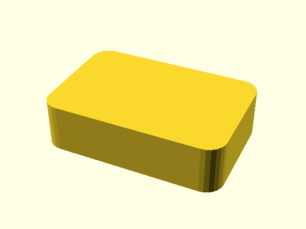

# Engine fixture

A tiny OpenSCAD library used to test the docs engine.



## Use it

```openscad
use <lib.scad>
rounded_block([30, 20, 8], r = 3);
```

The module is in [lib.scad](lib.scad), and [the block example](examples/block.scad) shows it in 3D. See [the notes](NOTES.md) and the [licence](LICENSE), or jump to [Use it](#use-it).


Text with braces, {{ like this }}, stays as written.
